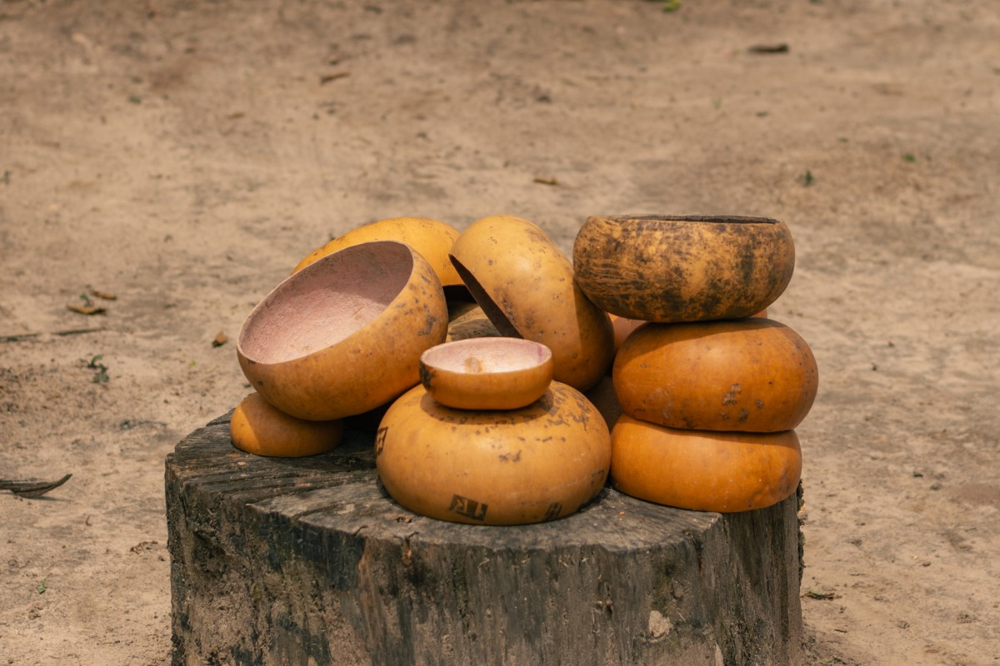
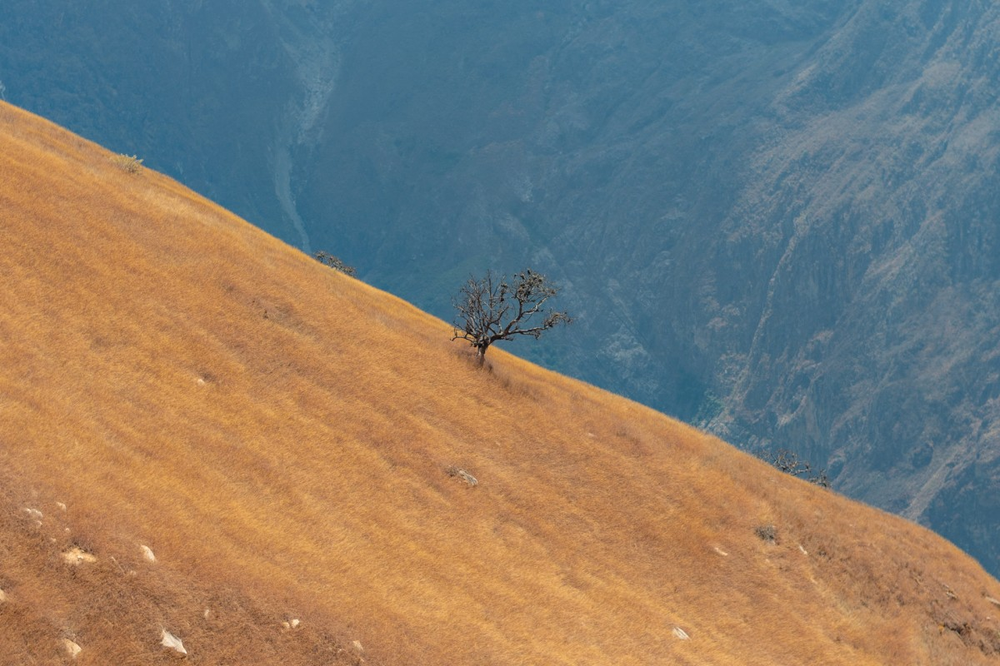
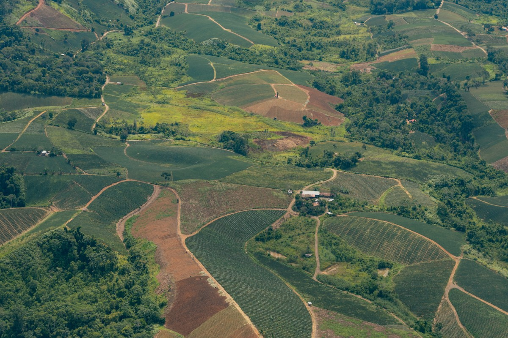
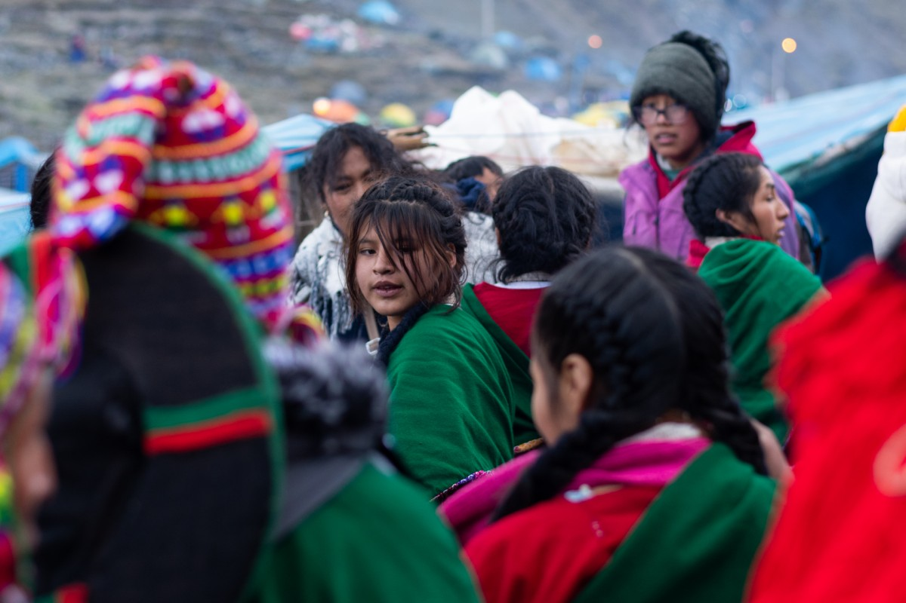
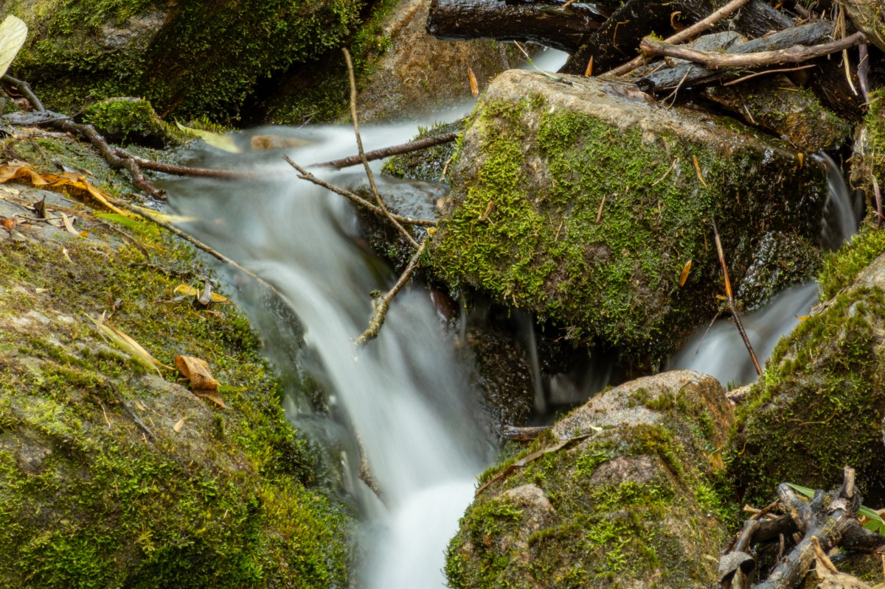
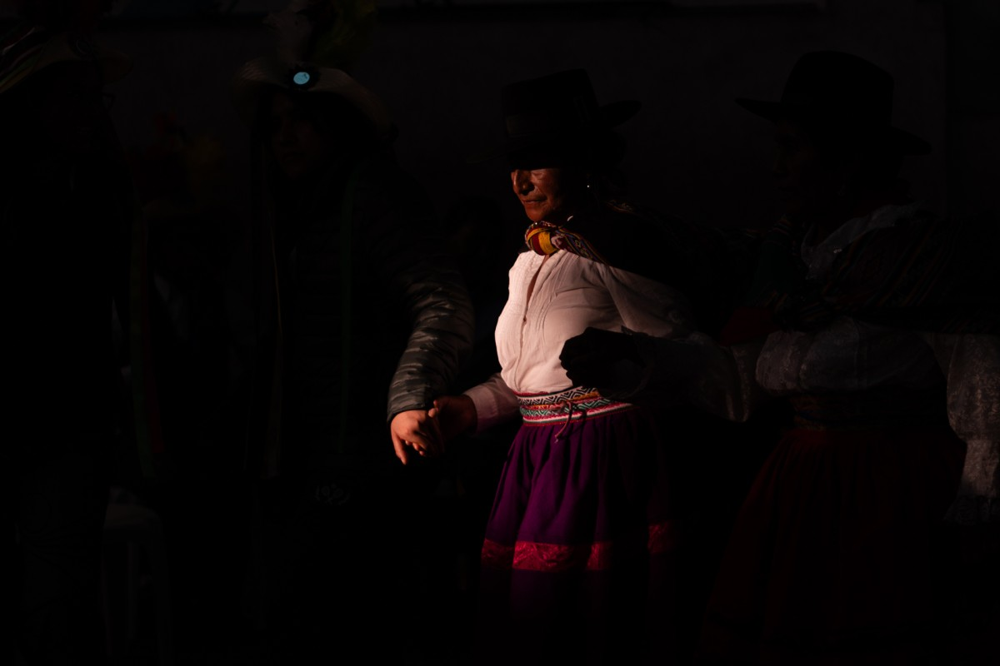
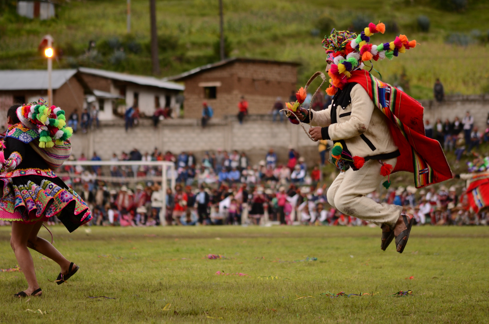
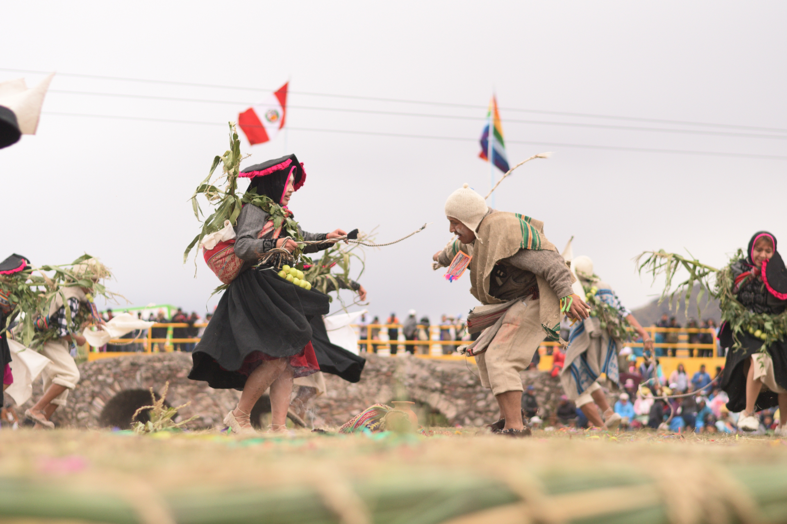
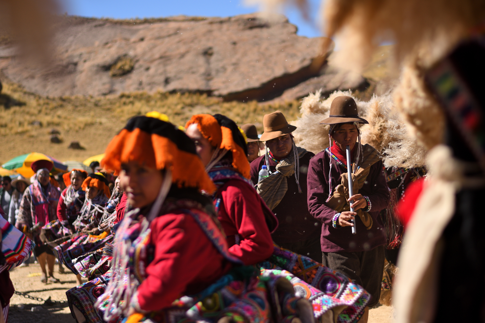

---

*Pajo asháninka, marzo del 2023*
  

*Modelo en la Plaza de armas de Cusco, enero del 2025*
 

*Arbol solitario en Choquequirao, agosto del 2024*
 

*Campos de cultivo en Junín, marzo del 2024*
 

*Peregrinación del Señor de Qoyllority, mayo del 2024*
 

*Riachuelo en muy muy lejano, agosto del 2024*
 

*Rayo de luz en Cusco, enero del 2025*
 

*Chita Saymay (Centro Cultural de Formación y Difusión Artística Amauta) en el Tikapallana, Tambobamba, 2 de marzo del 2024*
 

*Qhaswa Costumbrista de Chumbivilcas (Centro Cultural de Formación y Difusión Artística Amauta) en Langui, 24 de noviembre del 2024*
 

*Unay Carnaval Soltera Suway (Centro Cultural de Formación y Difusión Artística Amauta) en el Cañon de Tinajani, 6 de junio del 2025*
 

---

> Cusco - Perú

---